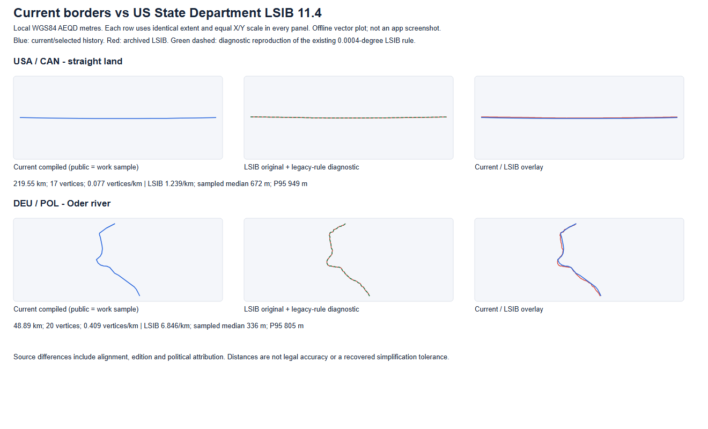

# Current border detail compared with LSIB 11.4

Measurement completed 2026-11-04. Runtime simplification was deliberately **not** applied: current borders have heterogeneous NE-based and exact-LSIB detail, and the selected applied historical examples do not demonstrate excess detail. No safe automatic historical generalization parameter was established. This completes the scoped comparison, not the requested eventual generalization of all historical borders.

The user meant the US State Department's **Large Scale International Boundaries**, not historical US territories. The archived edition is 11.4, published 2025-02-24, 395 original features, 43,179,013 compressed bytes. Its exact compressed master SHA256 is de87a3d317b7c18c07a8d16d1299778aaa19fd43a8d7b06a1217ac397cbd4194; provenance.json records upstream ZIP/SHP/DBF identities. This original was verified and not replaced. [Official LSIB catalog](https://geodata.state.gov/geonetwork/srv/api/records/3bdb81a0-c1b9-439a-a0b1-85dac30c59b2).

Two live observations occurred during measurement: the initial setup read reported app **2bd0623da46b8e81e7d35d9a417b345c6802d496** (its exact UTC timestamp was not retained); the separately archived build-meta.js read at **2026-11-04T12:07:10.895Z** reported app **f8a3f4b1252851ac479747c8ecb3e950f26fdc96**. Both reported data **0388abf78dff4ea4835e36b01de67d10703ac596**. The deployment advanced between these observations; no new deployment was initiated by this task. Measurements read that immutable data pin, rather than live rendered frames, so they do not assume one unchanged live app SHA. Work/gis remains paired to **89bff9a4c9ed42a7bca5325a3449fbe8055012e8**, including A-C/G/Sarakhs retirement and the automatic places followup. Public and work compiled chains coincide in the selected modern windows. Native/source/compiled raw identities are separately recorded: e.g. public CHN retains a native G mismatch and CHN/POL compiled hashes differ from their source globally; this task did not rewrite them or assume global parity from one shared-line sample.

| Window | Current / LSIB km | Current / LSIB vertices per km | Pooled median / P95 / sampled maximum metres | Current / LSIB length ratio |
|---|---:|---:|---:|---:|
| lsib-paektu | 21.24 / 21.24 | 23.586 / 23.586 | 0.0 / 0.0 / 0.0 | 1.00000 |
| lsib-river | 63.99 / 76.62 | 0.578 / 12.216 | 426.2 / 1213.6 / 1872.6 | 0.83508 |
| straight | 219.55 / 219.52 | 0.077 / 1.239 | 672.3 / 949.2 / 951.8 | 1.00012 |
| mountain | 26.64 / 36.60 | 0.563 / 67.261 | 1195.7 / 1775.9 / 2224.5 | 0.72771 |
| river | 48.89 / 50.98 | 0.409 / 6.846 | 335.9 / 805.3 / 965.7 | 0.95890 |
| lake | 99.23 / 100.39 | 0.161 / 1.036 | 562.1 / 1121.9 / 2168.4 | 0.98845 |

The first four NE-based windows are straight land (USA/CAN), mountain land (AUT/LIE), river (DEU/POL) and lake (USA/CAN Lake Superior). Straight/river native vertex densities are about 1/16 and 1/17 of LSIB; those are density ratios, not percent simplification or positional accuracy. Paektu is an exact reuse of 501 LSIB vertices over 21.24km: the near-zero result is a same-source check. The other CHN/PRK river diagnostic lies outside the recipe's Paektu refinement; LSIB citation in a country object does not mean every boundary segment was replaced. Its island-attribution semantics and multiple components exclude it from calibration. Rejected first Lake St Clair window was replaced by the single-component Lake Superior window because correspondence/endcuts were unsuitable.

Method: common fixed geographic windows and transverse cuts; extract both nations' shared compiled boundary with OGR, select the same connected route, project WGS84 coordinates with sample-centred PROJ azimuthal equidistant metre CRS. All geographic/native and projected vertices, window extents, LSIB IDs, versions and component counts are in samples.json. Cut endpoints remain in their actual positions; endpoint offsets are reported rather than snapped/hidden. These are comparable route/extent diagnostics, **not a fixed common survey-monument calibration**. Source editions, registration, river position, political attribution and coarse geometry all contribute. Source line segments are treated as straight between projected native vertices; long sparse segment/projection interpolation effects are part of this diagnostic and are not claimed as ground-survey error.

Lengths, native vertex spacing quantiles, vertices/km, length/chord ratio and absolute turns at a common physical 1km maximum sampling step are separate statistics. Distances use both directions of uniform arc-length point-to-polyline samples (100m, then 50m; actual sample counts retained). Pooled quantiles weight roughly by route length; directional quantiles are also provided. Finite-resolution sampled maxima are not exact continuous Hausdorff bounds. The mountain maximum changes by about 16.5m between these resolutions; no exact convergence is claimed. [NE projection-friendly vertices](https://www.naturalearthdata.com/features/) are another reason not to infer an original DP tolerance from point spacing.

Existing 0.0004-degree LSIB display policy is documented in the archived 2026-10-21 report (logical reports/geography/country-files-lsib-2026-10-21.md, archive blob 52110267275117ef3736f83188a89db604a1d5330f6a3558bc8e947144e57753.gz, 43,281 decoded bytes). Current canonical implementations are tools/gis/lsib-targeted.mjs, lsib-untargeted.mjs and tools/cpp/historical-lsib-screen-distance.inc. They are scoped candidate/application paths with protected coast/tripoint/dispute handling, not a renderer-wide rule. tools/build-korean-boundaries.mjs directly reuses the Paektu LSIB chain and does not apply that tolerance. A diagnostic reproduction on clipped reference chains keeps 8 straight, 92 mountain, 112 river and 7 lake vertices; it does not reproduce the current NE chains. Its output is kept separate and was not stored as runtime data. Degrees are not a uniform ground-metre bound; projection/interpolation of long simplified segments also affects these diagnostics.

Actual applied historical samples: USSR/IRN Atrek (1922-12-30..1925-05-12) has 17 vertices over 36.29km, **0.468/km**, versus the modern river sample's 0.409/km. The applied 1948 PRK 38th-parallel window has two endpoints over 87.83km, **0.0228/km**. Neither supports further automatic reduction. DDR Berlin (7.821/km) and Elbe (1.687/km) are source-only candidates absent from the active compiled country descriptors; they are not reported as already applied. Urban Berlin is a different feature type and cannot calibrate ordinary international boundaries. Historical route/ownership is not tested against present LSIB as a positional truth. [Historical sample plot](historical-detail.png).

Implementation decision: retain current masters and all runtime shapes. No historical event was generalized in this step; no shared arc, hierarchy, lifetime, date, island, hole or corridor changed. In particular A-C/G/Sarakhs remain retired (five focused retirement tests passed). No future automatic generalizer was enabled. The reusable addition is tools/gis/measure-border-detail.mjs, accepting explicitly selected projected-chain JSON only, plus four synthetic tests. Future selected events can reuse these measurements before a shared-arc display derivative is reviewed; they cannot infer a tolerance from these offsets. Existing topology-preview owner, LSIB shared-line candidate path, and Caspian-specific display generalizer were reviewed. Per-feature polygon simplification was rejected because it can break adjacent sharing ([GDAL documentation](https://gdal.org/en/stable/programs/gdal_vector_simplify.html)); Caspian's source-specific tolerances were not generalized worldwide. Minimum next decision, if proceeding beyond this comparison: identify the named historical display boundary to adjust and choose its comparable NE-based type or documented LSIB-detail exception; these measurements do not justify an all-history automatic rule.

Visual QA: comparison-summary.png, current-lsib-comparison.png and historical-detail.png are offline vectors rendered by existing headless Edge, same extent/projection/scale within each row. They are **not actual viewer screenshots**, and no app zoom/DPR accuracy claim is made. Final PNGs were opened for review. Qt and standalone Chromium raster attempts did not complete; Edge HTML embedding succeeded. No new render framework or dependencies were installed.

Verification scope: four synthetic measurement tests and five scoped A-C/G/Sarakhs tests passed, plus changed-file checks. No global source audit, full GIS regeneration, whole suite, app-main integration, deployment or packaging. Runtime pin unchanged; report archival commit and app measurement-tool commit are independent and recorded in completion.json. Cleanup retains only original archived sources and these task evidence files; task staging is removed after copied-byte verification.
