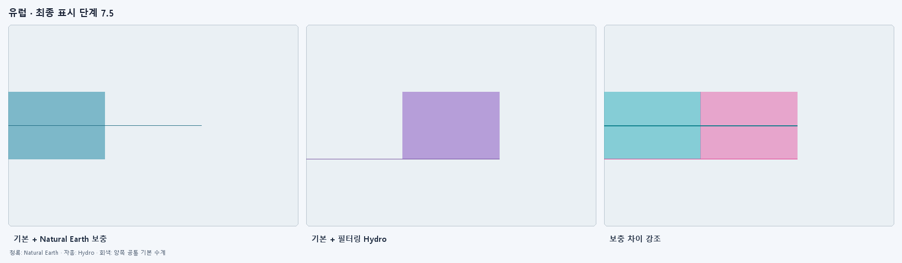

# 판도연구소 수계 자료 캘리브레이션 보고서

이 보고서는 Natural Earth 전 세계 기본 수계를 유지한 상태에서 HydroRIVERS/HydroLAKES 보충 후보를 유럽·북미·호주의 Natural Earth 1:10m 보충 레이어와 같은 화면 밀도로 맞춘 분석 결과입니다. 판도연구소 실행 자산은 교체하지 않았습니다.

## 결론

**보류 · 현재 제약으로는 전 세계 교체에 사용할 수 없습니다.**

- 통과: `riverFinalWithin15Percent`
- 통과: `intermediateScreenWithin25Percent`
- 통과: `lakeFinalWithin20Percent`
- 통과: `baseOverlapBelow2Percent`
- 미통과: `representativeFeaturesPresent`

세 기준 지역에 지역별 예외값을 두지 않고 같은 공식과 같은 단계 임계값을 사용했습니다. 비교 비율은 실제 표시 조합인 `(Natural Earth 기본 + Hydro 보충) / (Natural Earth 기본 + Natural Earth 보충)`이며 1.0에 가까울수록 같은 밀도입니다. 미통과 항목이 하나라도 있으면 런타임 자료를 교체하지 않습니다.

## 최적 탐색값 (합격 기준 미달)

- 강: `ORD_STRA + 1.00 × log10(DIS_AV_CMS) -0.50 × log10(UPLAND_SKM)`
- 강 임계값: 6.0 → 4.0969, 6.7 → 4.0969, 7.0 → 4.0969, 7.5 → 4.0969
- 호수: `1.00 × log10(Lake_area) + -5.00 × log10(Shore_len)`
- 호수 임계값: 6.0 → -3.8165, 6.7 → -3.8165, 7.0 → -3.8165, 7.5 → -3.8165
- 강 중복 판정: 기본 강 4 km 회랑과 중첩 길이, 주방향 유사도를 함께 사용했습니다.
- 호수 중복 판정: 기본 호수와의 IoU, 객체 면적 중첩률, 중심점 및 경계 거리를 함께 사용했습니다.

## 지역별 결과

### 유럽



| min_zoom | 표시 강 수 | 강 길이 비 | 강 화면 비 | 표시 호수 수 | 호수 수 비 | 호수 화면 비 |
|---:|---:|---:|---:|---:|---:|---:|
| 6.0 | 2 | 1.000 | 1.000 | 1 | 1.000 | 1.000 |
| 6.7 | 2 | 1.000 | 1.000 | 1 | 1.000 | 1.000 |
| 7.0 | 2 | 1.000 | 1.000 | 1 | 1.000 | 1.000 |
| 7.5 | 2 | 1.000 | 1.000 | 1 | 1.000 | 1.000 |

기본 수계 잔여 중복: 강 0.0%, 호수 0.0%.


## 연결 체인과 전 세계 예상치

아래 수치는 현재 최적 탐색값을 적용한 참고치이며, 미통과 상태이므로 배포 용량 계획에 사용하면 안 됩니다.

- 기준 지역 최종 선택 reach: 2개
- 연결 후 체인: 1개 (50.0% 감소)
- 좌표: 4개 → 4개 (삭제·단순화 없음)
- 전 세계 예상 reach: 8,500,000개
- 전 세계 예상 체인: 4,250,000개
- 전 세계 예상 강 좌표: 17,000,000개
- 전 세계 예상 호수 객체: 1,427,688개
- 예상 gzip 압축 용량: 약 530.7 MiB
- 최종 단계 렌더 부하는 현재 Natural Earth 지역 보충 수계 대비 강 0.00배, 호수 0.00배로 추정합니다.

## 대표 수계 확인

- 나일강: 누락
- 다뉴브강: 누락
- 미시시피강: 누락
- 머리강: 누락
- 오대호: 누락

## 재현 방법

다음 명령은 기존 `results.json`에서 보고서만 다시 만듭니다. 원본 수계 보정 계산이나 PNG 생성은 실행하지 않습니다.

```powershell
node tools/gis/hydro-calibration-report.mjs `
  --input <results.json> `
  --output <새-보고서.md> --verify-acceptance
```

`results.json`에는 공식, 단계별 원시 지표, 중복률, 입력 파일 정보가 들어 있습니다. 비교 PNG는 동일 범위·등거리 경위도 화면·동일 선폭으로 생성했습니다. 회색은 양쪽에 공통인 Natural Earth 기본 수계입니다. 한반도는 Natural Earth 지역 보충 자료가 없으므로 현재 전 세계 기본 수계를 왼쪽 기준으로 표시하며 최적화 목적함수에는 넣지 않았습니다.

## 적용 경계

이번 결과는 캘리브레이션 도구와 검증 자료뿐입니다. `assets/data/hydro`, 앱 버전, 내장 수계 잠금·편집용 복사 및 GeoPackage 구조는 변경하지 않았습니다. 실제 교체에 앞서 Natural Earth 지역 보충 자료 자체의 지역별 밀도 차이를 허용할지, 또는 전 세계 공통 절대 밀도 기준을 새로 정할지 결정해야 합니다.
